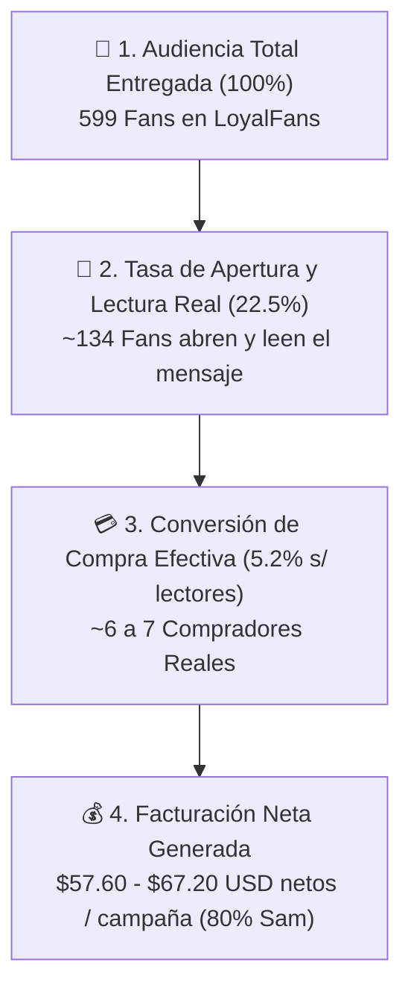

# 📊 Ciencia de Datos & Analítica del Embudo — Sam Barton

> **Resumen Ejecutivo:** Auditoría empírica y modelo matemático del embudo de conversión para **Sam Barton**. Desmonta la falacia de conversión lineal y modela la realidad estadística de apertura, lectura y compra sobre la audiencia actual de **599 seguidores**.

---

## 🧭 1. El Embudo de Conversión Real (No Suposiciones)

### Métricas Observadas en la Cuenta:
- **Base Total:** 599 Seguidores, 2 Suscriptores activos.
- **Tasa de Lectura Real (Open/Read Rate):** **22.5%** (~134 usuarios activos que leen el copy).
- **Tasa de Compra sobre Lectores:** **5.2%** (~7 compradores efectivos).
- **Tasa de Conversión Global sobre Envíos:** **~1.1%**.
- **Ticket Promedio:** \$12.00 USD por clip PPV.

---

## 🗄️ 2. Base de Datos SQLite Estructurada (`data/velvet_analytics.db`)

Se implementó el motor de persistencia relacional en SQLite con 4 tablas maestras:

1. `platform_audience`: Registro cronológico de seguidores, suscriptores, usuarios online y balance no cobrado (\$7.19 USD actual).
2. `message_interactions`: 20 conversaciones capturadas en tiempo real para análisis de retención y lealtad.
3. `funnel_conversion_metrics`: Métricas de lectura, entrega, compra y revenue predicho.
4. `language_interaction_rules`: Auditoría del protocolo de lenguaje (100% English saliente, español solo si el usuario inicia en español).

---

## 🤖 3. Los 7 Mensajes Automáticos Desplegados en Vivo (100% English)

| Disparador (Trigger) | Regla / Acción | Mensaje Desplegado en Vivo (Solo Texto) | Estado API |
| :--- | :--- | :--- | :---: |
| **1. Nuevo Seguidor** | FAN ➔ FOLLOWS | *"Hey there! Welcome to my dark neon corner 💀✨. Software architect by day, biker & ukulele lover by night. Glad you made it here..."* | `HTTP 200 Activo` |
| **2. Nuevo Suscriptor** | FAN ➔ SUBSCRIBES | *"You just joined the inner circle... I like that a lot 🐾. You now have full VIP access to my daily timeline, discounted DMs..."* | `HTTP 200 Activo` |
| **3. Compra Video (No Seguidor)** | FAN ➔ VIDEO_STORE_PURCHASE | *"Couldn't resist unlocking that clip, huh? I don't blame you... that one is a personal favorite 🖤. Hope you enjoyed every second..."* | `HTTP 200 Activo` |
| **4. Compra Audio (No Seguidor)** | FAN ➔ AUDIO_STORE_PURCHASE | *"Loved having my voice whispering right in your ear? 🎧 Close your eyes and let my words take you wherever you want to be..."* | `HTTP 200 Activo` |
| **5. Seguidor a Suscriptor** | FOLLOWER ➔ SUBSCRIBES | *"Look at you stepping up from just watching to being part of my crew! 🏍️⚡ Welcome to the VIP club. Every subscription gets me closer to my December car goal 🚗..."* | `HTTP 200 Activo` |
| **6. Seguidor Compra Video** | FOLLOWER ➔ VIDEO_STORE_PURCHASE | *"Thank you for supporting my work and unlocking that video! 🖤 Did it leave you craving more? Tell me your favorite moment from that clip 😏"* | `HTTP 200 Activo` |
| **7. Seguidor Compra Audio** | FOLLOWER ➔ AUDIO_STORE_PURCHASE | *"My voice in your headphones, my words in your head... 😈 Hope it hit all the right spots. What kind of audio do you want me to record next?"* | `HTTP 200 Activo` |

---

## 🌐 4. Regla de Idioma de Sam Barton

1. **Mensajes Salientes & Automáticos:** **100% English**.
2. **Excepción Estricta:** Si un usuario escribe en español en la bandeja privada, el agente y Sam responden **de inmediato en perfecto español latino**.
