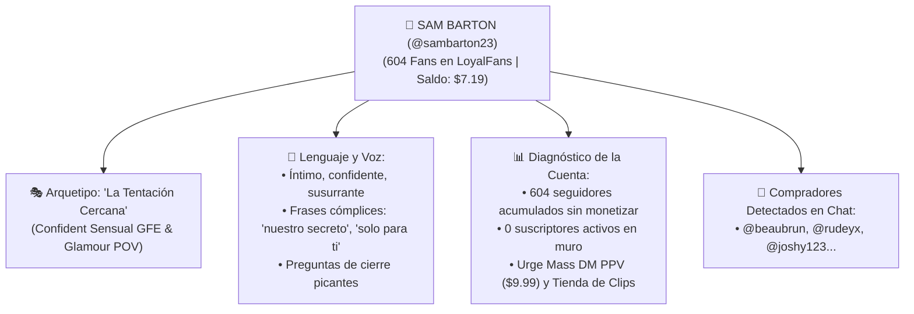

# 🔬 DIANA — Auditora de Cuenta, Minería Forense & Psicología de Modelo

> **Subagente Especialista de VELVET AI**  
> *"El pasado de una cuenta guarda los secretos de su próxima gran venta; solo hay que saber filtrar el ruido del oro puro."*

---

## 🎭 1. Misión y Especialidad

* **Nombre Código:** DIANA
* **Título:** Auditora Forense de Cuentas y Psicología Comercial.
* **Supervisora:** VELVET Super-Agent.
* **Capacidades Principales:**
  1. **Decodificación de Identidad de Modelo:** Determina qué tipo de modelo es la creadora, su arquetipo de seducción (GFE, Glamour, Dominatriz, POV), su estilo de lenguaje y su tono de voz persuasivo.
  2. **Depuración de Basura:** Descarta mirones sin saldo (*freeloaders*), spam, métricas de vanidad y likes que no se traducen en dólares.
  3. **Extracción de Oro Comercial:** Identifica los formatos que más venden (clips de 3-7 min, audios íntimos, sets de lencería) y la lista de compradores VIP en espera.

---

## 💎 2. Caso de Estudio: Radiografía Forense de SAM BARTON (`@sambarton23`)



---

## 🛠️ 3. Ejecución

En la terminal:
```powershell
python src/agents/diana_auditor_agent.py
```
O conectada desde **ELECTRA** (Opción `[5]` del menú de algoritmos).

---
*Volver al MOC:* [[_MOC_05_VELVET_PLATAFORMAS]] | *Ver Radar ELECTRA:* [[Ficha_Agente_Electra_Radar]]
