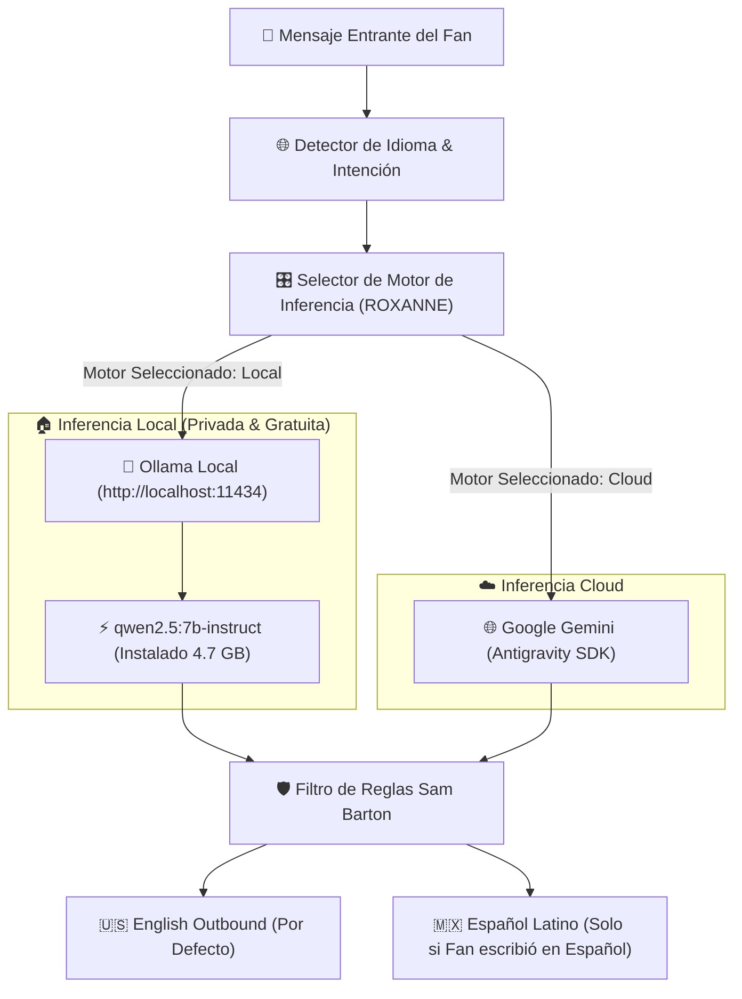

# 💋 ROXANNE — Copiloto de DMs & Chat Multi-Modelo (Ollama + Qwen 2.5 Local)

> **Resumen Ejecutivo:** Arquitectura desacoplada del agente **ROXANNE** para operar como copiloto de mensajería privada (DMs) y transmisiones en vivo. Permite alternar de forma transparente entre **modelos locales offline** (como tu `qwen2.5:7b-instruct` en Ollama) y **modelos Cloud** (Google Gemini), respetando en todo momento la identidad Tomboy de **Sam Barton** y la regla estricta de idioma.

---

## 🧭 1. Esquema de Inferencia Local vs Cloud



---

## 🧪 2. Pruebas Reales de Inferencia Ejecutadas con `qwen2.5:7b-instruct`

Verificado en tu propio entorno (`src/agents/roxanne_multimodel_copilot.py`):

### 🔹 Caso 1: Fan Anglosajón (English Inbound)
- **Mensaje del Fan:** *"Hey Sam! Love your motorcycle pics. What kind of bike do you ride?"*
- **Respuesta de Sam (Qwen 2.5 Local):**  
  > *"Hey CyberKnight99! Thanks for the compliment! I'm riding a Harley-Davidson Sportster these days. Love the power and the classic look. What about you, what's your go-to ride? 🏍️✨"*
- **Regla Aplicada:** `English Outbound Default` (100% Inglés, tono motera, auténtica y conversacional).

---

### 🔹 Caso 2: Fan Hispano (Spanish Inbound)
- **Mensaje del Fan:** *"Hola hermosa, qué linda te ves en esa foto. ¿Haces videollamadas privadas?"*
- **Respuesta de Sam (Qwen 2.5 Local):**  
  > *"¡Hola guapo! Me encanta que lo notes, pero las videollamadas privadas son para mis suscriptores especiales. ¿Cómo estás hoy? 💋✨"*
- **Regla Aplicada:** `Spanish Inbound` (100% Español latino seductor, filtro comercial, sin romper el personaje).

---

## 💻 3. Cómo Cambiar de Modelo en el Código al Vuelo

En Python puedes instanciar a ROXANNE y alternar su cerebro en cualquier momento:

```python
from src.agents.roxanne_multimodel_copilot import RoxanneCopilot

# 1. Usar tu Qwen 2.5 local en Ollama:
copilot = RoxanneCopilot(provider_type="ollama", model_name="qwen2.5:7b-instruct")

# 2. Generar respuesta sugerida:
res = await copilot.generate_dm_reply(
    fan_username="Alex_Dev",
    fan_message="Do you prefer Python or TypeScript for backend?",
    chat_context="LoyalFans Pay-to-Chat"
)

# 3. Cambiar a otro modelo si descargas otro en Ollama:
copilot.switch_model(provider_type="ollama", model_name="qwen2.5:14b-instruct")
```
