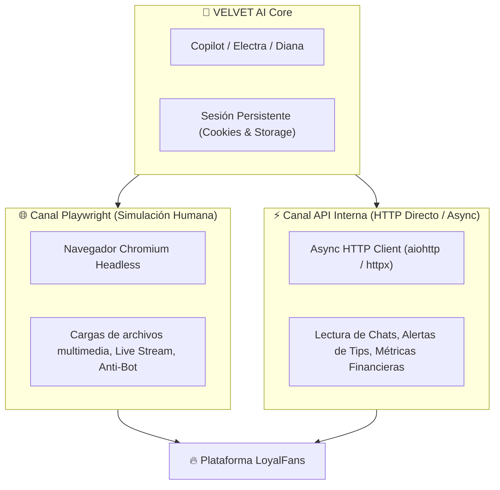

# ⚡ Catálogo Forense de Endpoints Internos de LoyalFans (`/api/v1` & `/api/v2`)

> Este catálogo documenta la **API REST interna** utilizada por la aplicación Angular de LoyalFans, interceptada y verificada en tiempo real mediante la sesión activa de **Sam Barton** (`@sambarton23`). Permite a los agentes de VELVET AI operar a velocidad nativa sin sobrecargar el navegador.

---

## 🧭 1. Resumen de Arquitectura Híbrida de VELVET AI



---

## 📊 2. Catálogo Completo de Endpoints Interceptados en Vivo

### 🔐 2.1 Autenticación, Estado y Presencia
| Endpoint | Método | Payload / Parámetros | Utilidad en VELVET AI |
| :--- | :--- | :--- | :--- |
| `https://www.loyalfans.com/api/v1/auth/user/me` | `GET` | N/A | Valida si la sesión sigue viva y extrae el ID de usuario interno, roles y balance. |
| `https://www.loyalfans.com/api/v2/system-status` | `POST` | `{}` | Mantiene el heartbeat de la cuenta en línea para que aparezca el badge verde de "En línea". |
| `https://www.loyalfans.com/api/v2/delegate/get-delegated-to` | `POST` | `{}` | Verifica permisos de agencia o gestión delegada. |

---

### 👤 2.2 Perfil, Configuración & Precios
| Endpoint | Método | Payload / Parámetros | Utilidad en VELVET AI |
| :--- | :--- | :--- | :--- |
| `https://www.loyalfans.com/api/v2/profile` | `GET` | N/A | Obtiene la configuración completa del perfil público de la creadora. |
| `https://www.loyalfans.com/api/v2/profile/me` | `POST` | `{"name": "...", "artist_type": "...", "about": "..."}` | **Actualización instantánea** de bio, nombre, tipo de creador y redes sociales. |
| `https://www.loyalfans.com/api/v2/settings/prices` | `GET` | N/A | Obtiene los precios actuales de suscripción mensual/anual y tiers. |
| `https://www.loyalfans.com/api/v2/pornstar-badge` | `GET` | N/A | Verifica el estado de verificación de insignia de creador. |

---

### 💰 2.3 Finanzas, Métricas y Ganancias
| Endpoint | Método | Payload / Parámetros | Utilidad en VELVET AI |
| :--- | :--- | :--- | :--- |
| `https://www.loyalfans.com/api/v2/profile/star/earnings` | `GET` | N/A | **Extracción de ganancias en tiempo real**: balance disponible, ingresos del mes, tips recibidos y desglose por clip. |

---

### 💬 2.4 Mensajería Privada (DMs) & Chat con Fans
| Endpoint | Método | Payload / Parámetros | Utilidad en VELVET AI |
| :--- | :--- | :--- | :--- |
| `https://www.loyalfans.com/api/v2/PM/list` | `POST` | `{"limit": 20}` | Lista de hilos de conversación activos ordenados por el más reciente. |
| `https://www.loyalfans.com/api/v2/messages` | `POST` | `{"limit": 20, "all": true}` | Buzón completo de mensajes entrantes. |
| `https://www.loyalfans.com/api/v2/PM/list/partner/{partner_hash}` | `POST` | `{"limit": 50}` | Historial completo de conversación con un fan específico para alimentar la memoria del agente. |
| `https://www.loyalfans.com/api/v2/PM/send` | `POST` | `{"partner_hash": "...", "message": "..."}` | Envío instantáneo de respuesta en chat o Mass DM. |

---

### 🛍️ 2.5 Tiendas de Contenido (Video Store & Audio Store)
| Endpoint | Método | Payload / Parámetros | Utilidad en VELVET AI |
| :--- | :--- | :--- | :--- |
| `https://www.loyalfans.com/api/v2/profile/star/videostore` | `GET` | N/A | Lista completa de videos en venta, precios, etiquetas y ventas acumuladas. |
| `https://www.loyalfans.com/api/v2/profile/star/audiostore` | `GET` | N/A | Lista de audios íntimos a la venta y estadísticas de compra. |

---

### 📢 2.6 Feed (Timeline), Historias & Eventos
| Endpoint | Método | Payload / Parámetros | Utilidad en VELVET AI |
| :--- | :--- | :--- | :--- |
| `https://www.loyalfans.com/api/v1/timeline` | `POST` | `{"limit": 10}` | Muro de publicaciones y posts recientes de Sam. |
| `https://www.loyalfans.com/api/v2/stories` | `POST` | `{"slug": "sambarton23"}` | Historias activas temporales (formato 24h). |
| `https://www.loyalfans.com/api/v2/stories/highlights` | `POST` | `{"slug": "sambarton23", "page": 1, "limit": 9}` | Historias destacadas fijadas en el perfil. |
| `https://www.loyalfans.com/api/v2/scheduled-events/future` | `POST` | `{"limit": 6}` | Calendario de futuros shows en vivo o transmisiones agendadas. |

---

### 👥 2.7 Fans, Suscriptores & Marketing
| Endpoint | Método | Payload / Parámetros | Utilidad en VELVET AI |
| :--- | :--- | :--- | :--- |
| `https://www.loyalfans.com/api/v2/profile/star/subscribers` | `GET` | N/A | Base de datos de todos los suscriptores activos (antigüedad, rebilling, nivel de gasto). |
| `https://www.loyalfans.com/api/v2/subscriptions-campaigns` | `POST` | `{"page": 1, "sort": "date", "dir": "desc"}` | Descuentos promocionales activos (ej: 20% off para captar suscriptores para la meta del carro). |

---

### 🔔 2.8 Notificaciones y Alertas en Tiempo Real
| Endpoint | Método | Payload / Parámetros | Utilidad en VELVET AI |
| :--- | :--- | :--- | :--- |
| `https://www.loyalfans.com/api/v1/notifications` | `POST` | `{"limit": 20, "group": ""}` | Detección de tips recibidos, nuevas compras y nuevos follows para responder con un mensaje de agradecimiento en menos de 3 segundos. |

---

## 🛠️ 3. Implementación en Python con Cookies de Sesión

Cualquier subagente de VELVET AI puede consumir estos endpoints usando las cookies guardadas en `data/browser_profiles/loyalfans_profile`:

```python
import httpx

# Cookies obtenidas del contexto persistente de Playwright
cookies = {
    # cookies de sesión activa
}

headers = {
    "User-Agent": "Mozilla/5.0 (Windows NT 10.0; Win64; x64)",
    "Referer": "https://www.loyalfans.com",
    "Accept": "application/json"
}

# Ejemplo: Consultar ganancias en 120 milisegundos sin abrir ventana de navegador
response = httpx.get("https://www.loyalfans.com/api/v2/profile/star/earnings", cookies=cookies, headers=headers)
earnings_data = response.json()
print("Balance actual:", earnings_data)
```
