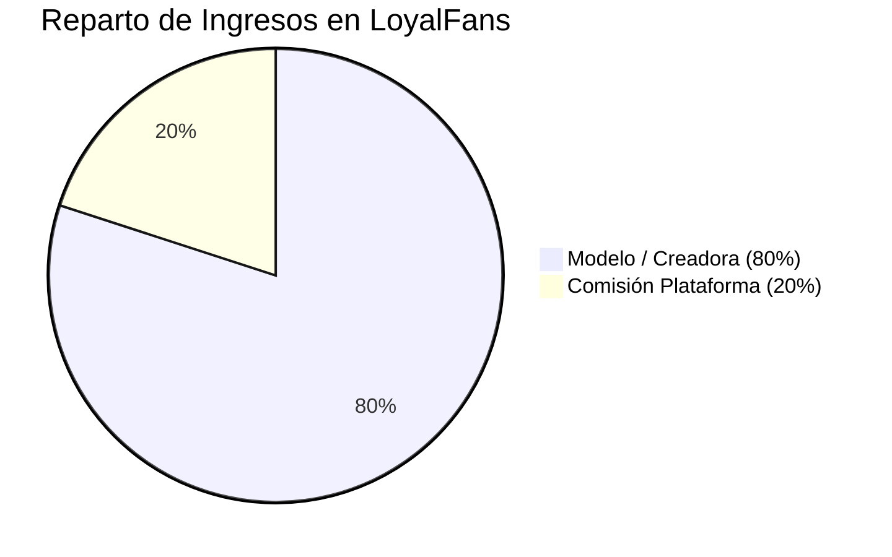
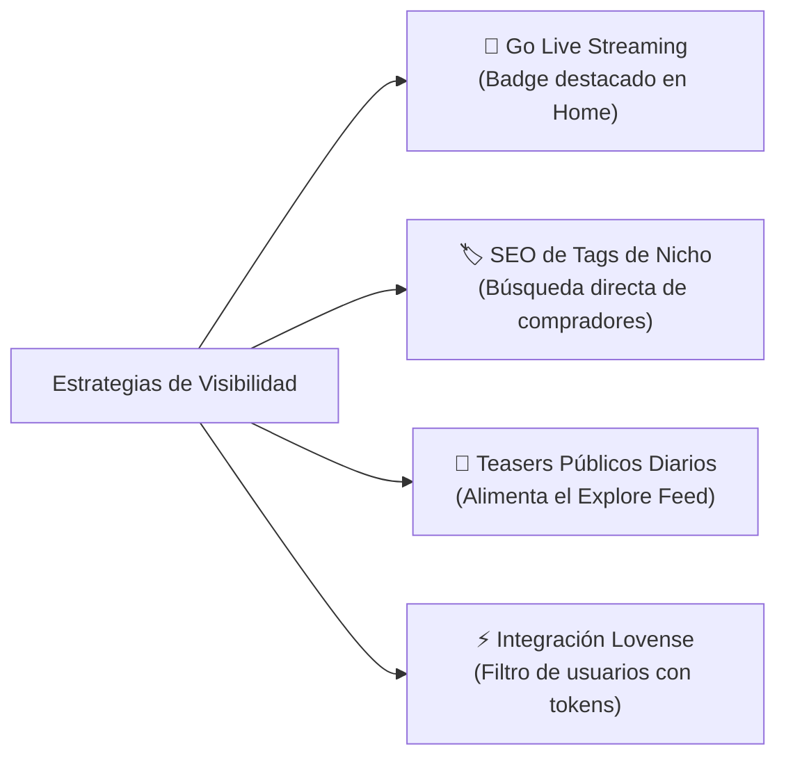

# 💎 LoyalFans — Auditoría Técnica, Funcionalidades, Facturación y Algoritmo

> **Dossier de Inteligencia Exhaustiva**  
> *Extraído mediante el scraper oficial de **ELECTRA** analizando los 29 manuales de creadoras y la arquitectura de monetización de LoyalFans.*

---

## 📌 1. Visión General de la Plataforma

**LoyalFans** es una plataforma híbrida de red social de suscripción, tienda a la carta y streaming en vivo para creadoras de contenido erótico y para adultos. 

> [!TIP] Diferencial Competitivo Frente a OnlyFans
> **OnlyFans es una plataforma "ciega":** no tiene barra de búsqueda pública ni feed de exploración; el 100% del tráfico debe traerlo la modelo desde redes externas (Twitter/X, Instagram, Reddit).  
> **LoyalFans tiene motor de descubrimiento interno:** cuenta con feed de *Explore*, barra de búsqueda optimizada para SEO de fetiches, directorio de transmisiones en vivo y herramientas nativas que permiten facturar a usuarios internos sin tener seguidores previos en redes.

---

## 🧰 2. Catálogo Completo de Herramientas y Funcionalidades

### 🔹 2.1 Tienda de Vídeos a la Carta (Video Store & Clips)
- **Venta unitaria perpetua:** Permite vender clips individuales en USD a cualquier visitante del perfil sin necesidad de que esté suscrito al muro.
- **Trailers / Teasers:** Generación de vistas previas de 5 a 30 segundos con marca de agua para despertar deseo de compra.
- **Categorización granular:** Etiquetas de fetiches, tabú, BDSM, cosplay, Findom, pies, etc., indexadas en la tienda general.

### 🔹 2.2 Tienda de Audio Exclusiva (Audio Store & Voice Notes)
- **Herramienta nativa diferencial:** Módulo dedicado para vender archivos de audio (audios eróticos, ASMR, fantasías habladas, gemidos, cuentos BDSM).
- **Muestras gratuitas:** Permite reproducir fragmentos de 5 a 15 segundos antes del desbloqueo.
- **Ventaja táctica:** Ideal para creadoras *faceless* (sin mostrar rostro) o modelos de dominación verbal; tiene mucha menor competencia que el formato de video tradicional.

### 🔹 2.3 Muro Social, Stories y Highlights (Timeline)
- **Publicaciones Gratuitas vs. Bloqueadas:** Capacidad de publicar posts públicos (para alimentar el Explore Feed) y posts exclusivos para suscriptores de pago.
- **Stories de 24 Horas:** Historias temporales para generar urgencia (FOMO) y mantenerse en la barra superior de los usuarios conectados.
- **Highlights fijados:** Carpetas temáticas en el encabezado del perfil (ej. "Lencería", "Detrás de cámaras", "Wishlist de regalos").

### 🔹 2.4 Go Live & Integración Interactiva con Juguetes
- **Transmisión en Vivo:** Módulo de streaming web con chat público y opción de privado.
- **Integración Lovense y Kiiroo:** Conexión nativa Bluetooth/Bridge con juguetes interactivos (Lush, Domi, Max, etc.).
- **Reacción Háptica por Propinas:** El juguete vibra automáticamente según el monto de la propina enviada en tiempo real.
- **Metas de Propinas (Tip Goals):** Barra de progreso interactiva para shows grupales o hitos de despojo de ropa.

### 🔹 2.5 One-on-One y Sesiones Privadas
- **Cam 2 Cam:** Transmisión bidireccional privada directamente desde el navegador, sin necesidad de Skype o software externo.
- **Llamadas y Videollamadas:** Tarifa configurada en USD por minuto por la propia modelo.
- **Disponibilidad:** Modo "Disponible ahora" o programación por citas.

### 🔹 2.6 Mensajería Masiva PPV y Reglas Inbound
- **Mass DMs:** Envío de mensajes privados masivos a toda la base de suscriptores y seguidores con multimedia bloqueada de pago (PPV).
- **Inbound Paid Messaging:** Configuración para cobrar a los fanáticos por enviar mensajes de texto o de voz directos a la modelo.
- **Plazo de respuesta:** Los mensajes con propina o de pago cuentan con un plazo estándar (habitualmente 72 horas) para ser atendidos.

### 🔹 2.7 Shoutouts y Pedidos Personalizados
- **Módulo de Custom Requests:** Los fans solicitan vídeos o fotos con requerimientos específicos (mencionar su nombre, vestuario concreto).
- **Control de la modelo:** La modelo define precio base, tiempo límite de entrega y tiene potestad de aceptar o rechazar solicitudes.

### 🔹 2.8 Seguridad, Geobloqueo y Cuentas Delegadas
- **Geoblocking Avanzado:** Bloqueo por países, regiones o estados específicos para proteger la privacidad local de la modelo.
- **Bloqueo de IPs y usuarios:** Restricción inmediata de acosadores o compradores problemáticos.
- **Cuentas Delegadas (Delegated Accounts):** Permite otorgar acceso a asistentes de chat (*chatters*) o agencias para responder mensajes y subir contenido sin dar visibilidad a datos bancarios, balances ni permitir retiros de dinero.

---

## 💵 3. Facturación, Comisiones y Esquema de Pagos

| Parámetro | Detalle Oficial |
| :--- | :--- |
| **Reparto de Ingresos (Split)** | **80% neto para la modelo** / 20% para LoyalFans en todas las transacciones (suscripciones, clips, propinas, llamadas). |
| **Comisiones Ocultas** | 0%. No cobran tarifas adicionales por setup ni por transacciones internas. |
| **Frecuencia de Pagos** | **Quincenal (Bi-monthly)**. Se procesa aproximadamente en 7 días hábiles tras el cierre del ciclo. |
| **Umbral Mínimo de Retiro** | **$50.00 USD** acumulados en balance disponible. |
| **Rango de Precios de Suscripción** | De **$1.00 USD a $50.00 USD** mensuales. |
| **Bundles & Promos** | Descuentos configurables por paquetes de 3, 6 y 12 meses, y campañas flash con cupos limitados. |

### Métodos de Pago Habilitados:
1. **Paxum:** E-Wallet preferida por la industria para transferencias inmediatas y retiros internacionales seguros.
2. **Bank Wire:** Transferencia bancaria internacional por código SWIFT / SEPA (sujeta a tiempos interbancarios de 2 a 5 días).
3. **ACH / Direct Deposit:** Depósito directo para creadoras con cuentas bancarias en Estados Unidos.

---

## 🧠 4. El Algoritmo de LoyalFans y Estrategia de Visibilización

### 🔍 4.1 ¿Cómo funciona el motor de recomendación?
El algoritmo de LoyalFans evalúa tres señales esenciales para posicionar un perfil:
1. **Velocidad de Engagement (Primeros 60 Minutos):** Si una publicación recibe propinas, likes o desbloqueos rápidos tras publicarse, el algoritmo la etiqueta como contenido de alto valor y la eleva al feed general de **Trending**.
2. **Afinidad de Consumo y Categorías:** Cada vez que un usuario interactúa con un tag (ej: `#femdom` o `#cosplay`), su feed de **Explore** prioriza perfiles que usan activamente esos tags.
3. **Actividad en Tiempo Real:** Los perfiles que están transmitiendo en vivo o tienen Stories recientes reciben prioridad frente a perfiles estáticos.

---

### 🚀 4.2 Multiplicadores de Tráfico Interno para la Modelo

1. **🔴 Transmitir en Vivo (Go Live) — *Multiplicador Máximo*:**
   * Las modelos transmitiendo en vivo aparecen en un carrusel dorado en la parte superior de la página principal. Esto canaliza tráfico de compradores en caliente sin invertir en publicidad.
2. **📸 Teasers Públicos Diarios — *Multiplicador Alto*:**
   * Un perfil con 100% del contenido bloqueado no puede ser indexado en Explore. Publicar 1 o 2 fotos o trailers diarios con 4 tags relevantes es el combustible del algoritmo.
3. **🏷️ SEO de Tags y Palabras Clave — *Multiplicador Alto*:**
   * En la bio y títulos se deben incluir términos concretos de búsqueda (fetiche, rol, idioma, atributos). Los usuarios de LoyalFans usan intensivamente la barra de búsqueda interna.
4. **🔌 Conexión de Juguetes Interactivos — *Multiplicador Medio-Alto*:**
   * El filtro "Interactive Toy Active" es de los más usados por compradores con saldo para dar propinas inmediatas.

---

## 🔄 5. Integración con los Agentes de VELVET AI

- **[[Ficha_Agente_Electra_Radar|ELECTRA]]:** Ejecuta el scraping y monitoreo de novedades, cambios de términos y tendencias de tags en LoyalFans.
- **SCARLETT (`src/agents/content_uploader_agent.py`):** Utiliza los datos de este documento para redactar los copies de alta conversión, sugerir los precios en USD (\$15-\$25 clips, \$8-\$12 sets) y empaquetar los posts listos para subir.
- **VELVET Super-Agent:** Supervisa la estrategia integral de monetización cruzada entre shows en vivo y LoyalFans.

---
*Volver al MOC:* [[_MOC_05_VELVET_PLATAFORMAS]] | *Ver Comparativa:* [[Matriz_Comparativa_Plataformas]]
