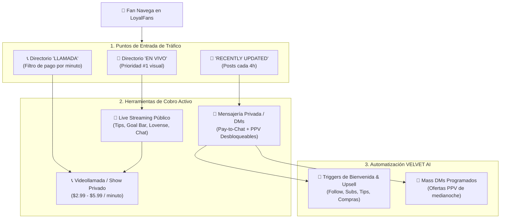
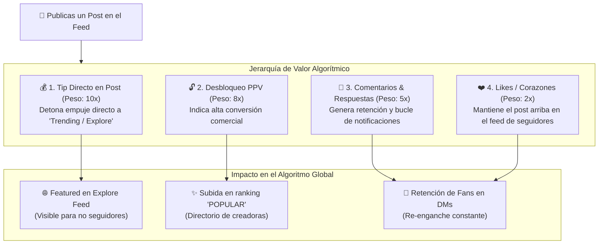

# 🎙️ LoyalFans: Guía Táctica & Arquitectura de Live, Videollamadas y Mensajería Privada (DMs)

> **Resumen Ejecutivo:** Análisis forense y manual de explotación táctica de las herramientas interactivas de LoyalFans: **Transmisión en Vivo (Live Stream)**, **Llamadas 1-on-1 (Cam-to-Cam / Audio)** y **Mensajería Privada (DMs / Mass PPV)**. Diseñado para maximizar los ingresos de **Sam Barton** y conectar con los agentes de **VELVET AI**.

---

## 🧭 1. Mapa de Flujo de Monetización Interactiva

---

## 🔴 2. Transmisión en Vivo (Live Streaming)

### 2.1 Cómo Opera el Algoritmo y Visibilidad
* **El Badge Rojo Parpadeante:** Al pulsar el botón *"TRANSMITIR EN VIVO"*, el perfil de Sam Barton se ilumina con un anillo rojo y un badge parpadeante.
* **Pestaña `🔴 EN VIVO` (`/creators?target=live`):** Apareces de forma automática en los primeros puestos del directorio de transmisión.
* **Banner de Portada:** Los usuarios conectados en la plataforma reciben una notificación y ven a las creadoras en vivo en la barra superior.

### 2.2 Modelos de Cobro en el Live
1. **Show Público con Barra de Objetivos (Tip Goals):**
   * El stream es gratis para que entren curiosos.
   * Configuras una barra de meta visible: *"Meta: Fondo para mi carro de diciembre 🚗💨 (\$50 / \$150 USD)"*.
   * Los fans envían propinas fijas (ej: 50, 100, 500 tokens) para desbloquear metas (ej: mostrar outfit deportivo, tocar una canción en ukelele, cambio a lencería neón).
2. **Show Privado (Private Show / 1-on-1):**
   * Configurado en tu panel [`/settings/stream`](https://www.loyalfans.com/settings/stream).
   * **Tarifa actual de Sam:** `$2.99 / minuto` (se puede ajustar a \$3.99 - \$4.99/min).
   * Cuando un fan pide privado, la sala pública se pausa y entras a una llamada exclusiva con él cobrada segundo a segundo.
3. **Modo Espía (Spy Mode):**
   * Los otros fans pueden pagar una tarifa reducida (ej: \$0.99/min) para "espiar" el privado sin interactuar.

---

## 📞 3. Videollamadas y Llamadas de Audio (1-on-1 Calls)

### 3.1 Cómo Funciona la Pestaña `LLAMADA` (`/creators?target=call`)
* **Baja Competencia:** Menos del 20% de las creadoras mantienen activas las llamadas directas. Activar tu disponibilidad te posiciona de inmediato en la **primera fila** de la pestaña `LLAMADA`.
* **Dos Modalidades:**
  * **Videollamada (Cam-to-Cam):** Tarifada por minuto (\$3.99 - \$6.99 USD/min).
  * **Llamada de Audio:** Perfecta si no quieres arreglarte o maquillarte. Llamadas de voz íntimas cobradas por minuto (\$1.99 - \$2.99 USD/min).
* **Depósito Previo de Seguridad:** LoyalFans retiene los fondos del fan por adelantado antes de conectar la llamada; si el fan se queda sin saldo, la llamada se corta automáticamente para que nunca regales tiempo.

---

## 💬 4. Mensajería Privada (DMs) & Precios Configurados

En la auditoría forense que realizamos a tu cuenta de Sam Barton, descubrimos cómo está configurado tu panel [`/settings/messages/messages-prices`](https://www.loyalfans.com/settings/messages/messages-prices):

### 4.1 Tu Configuración de Cobro por Mensaje (Pay-to-Message)
LoyalFans te permite cobrarle a los usuarios **solo por escribirte o mandarte fotos**:

| Tipo de Mensaje | Precio para No Suscriptores (Followers) | Precio para Suscriptores |
| :--- | :---: | :---: |
| **Mensaje de Texto** | **\$0.50 USD** | **\$0.10 USD** |
| **Imágenes** | **\$0.50 USD** | **\$0.20 USD** |
| **Videos** | **\$0.50 USD** | **\$0.20 USD** |
| **Audios de Voz** | **\$0.50 USD** | **\$0.20 USD** |
| **GIFs** | **\$0.50 USD** | N/A |

> **Impacto Financiero:** Filtra a los mirones y curiosos sin dinero. Si un fan quiere tu atención, cada mensaje le cuesta \$0.50 USD que va directo a tu balance.

---

## 🤖 5. Los 7 Disparadores Automáticos (Messages Automation)

LoyalFans incluye un motor nativo de automatización en [`/settings/messages/messages-automation`](https://www.loyalfans.com/settings/messages/messages-automation). Estos son los 7 disparadores que VELVET AI puede programar con los textos de Sam:

| Disparador (Trigger) | Evento que lo detona | Mensaje Recomendado de Sam Barton (En Inglés) |
| :--- | :--- | :--- |
| **1. Nuevo Seguidor (Follow)** | Un fan da clic en "Seguir" (gratis). | *"Hey! Welcome to my dark neon corner 💀✨. Software architect by day, biker & ukulele lover by night. Check out my exclusive clips below or unlock my full world 💋"* |
| **2. Nuevo Suscriptor** | Un fan paga la suscripción mensual. | *"You just made my day! Welcome to my inner circle 🐾. You get discount DMs and full access to my daily timeline. What got you hooked? The tech brain or the biker attitude? 😈"* |
| **3. Compra de Video (No Seguidor)** | Un usuario externo compra un clip en la Videoteca. | *"Thank you for unlocking my video! Hope you enjoyed every second 🖤. Did you know you can get all my clips at 50% off by joining my VIP club? Slide into my DMs 🚗💨"* |
| **4. Compra de Audio (Audioteca)** | Un usuario compra un audio íntimo. | *"Loved having my voice in your ear? 🎧 I post exclusive voice notes right here. Tell me what fantasy you want next..."* |
| **5. Propina Recibida (Tip)** | Un fan envía cualquier tip (\$1 - \$100). | *"Thank you so much for the tip! 🖤 Every dollar goes straight to my December car fund 🚗💨. You're officially one of my favorites."* |
| **6. Suscriptor compra video** | Un miembro de pago compra un clip extra. | *"Special bonus for a loyal member! Sending you warm kisses from Cancun dreams 🌴"* |
| **7. Re-suscripción** | Un miembro renueva su membresía. | *"Month 2 together! Let's make it even crazier 😈"* |

---

## 🚀 6. Estrategia de Mass DMs (Mensajes Masivos PPV)

* **¿Qué es?**  
  Envías un mensaje simultáneo a tus **600+ fans** con una foto o video bloqueado (ej: \$9.99 USD).
* **La Tasa de Conversión:**  
  Con 600 seguidores, si solo el **3% compra** (18 fans x \$9.99 USD), generas **\$179.82 USD en 5 minutos**.
* **El Ángulo de Sam Barton para Mass DMs:**
  * *"Acabo de llegar de rodar en moto con este frío... mojada y con ganas de calentarme 🏍️🌧️. Desbloquea para ver lo que traigo debajo del cuero (\$9.99 USD)"*.
  * *"Programando código en lencería con mis 2 gatas encima 💻🐈. Ayúdame con la meta del carro de diciembre y mira este clip exclusivo (\$12 USD)"*.

---

## 📈 7. Impacto Algorítmico de Reacciones e Interacciones en el Feed

> En LoyalFans, el Feed no es solo un muro estático; es un **motor de tracción algorítmica**. Cada reacción (Like, Comentario, Tip en post, Desbloqueo) altera directamente el alcance orgánico de Sam Barton en toda la plataforma.

---

### 7.1 La Jerarquía de Valor de las Interacciones en LoyalFans

No todas las acciones de un fan valen lo mismo para el algoritmo de LoyalFans:

| Tipo de Interacción | Icono en Plataforma | Peso Algorítmico | Por qué le importa a LoyalFans |
| :--- | :---: | :---: | :--- |
| **1. Propinas en el Post (`Tip`)** | `💰 Tip` | **Máximo (10/10)** | LoyalFans gana el 20% de cada propina. Si un post genera propinas directas en sus primeros minutos, el algoritmo lo etiqueta como *"High Value Content"* y lo empuja a la portada del Explore Feed. |
| **2. Desbloqueo de Post PPV** | `🔓 Desbloquear` | **Muy Alto (8/10)** | Demuestra que los usuarios están sacando la tarjeta por ese contenido. Eleva a la creadora en la pestaña `POPULAR`. |
| **3. Comentarios** | `💬 Comentar` | **Alto (5/10)** | Mide el tiempo de permanencia (Dwell Time). Además, **cada respuesta de Sam envía una notificación al fan**, haciéndolo volver a la web. |
| **4. Likes (Corazones)** | `❤️ Like` | **Medio (2/10)** | Señal básica de afinidad. Evita que el post se hunda en el feed cronológico de los seguidores. |

---

### 7.2 La Regla de Oro de los Primeros 60 Minutos (Velocity Rate)

LoyalFans mide la **Velocidad de Interacción** inmediatamente después de publicar:

1. **La Primera Hora es Decisiva:**  
   Si en los primeros **60 minutos** un post recibe al menos **5 a 10 likes y 2 o 3 comentarios/tips**, el algoritmo lo califica como *"Trending"* y lo mantiene en los primeros lugares del muro de inicio de los suscriptores durante más de **24 horas**.
2. **El "Efecto Olvido" de los Posts Planos:**  
   Si publicas una foto sin texto ni llamado a la acción (CTA) y no recibe interacción en la primera hora, el algoritmo la entierra rápidamente conforme otras modelos publican.

---

### 7.3 El "Bucle de Notificaciones" (Notification Loop)

* Cuando un fan comenta en una foto de Sam y el copiloto de **VELVET AI (ROXANNE)** responde con una frase pícara o un reto en menos de 5 minutos:
  1. El fan recibe una **alerta roja en su campana de notificaciones** (`🔔`).
  2. Vuelve a entrar al perfil de Sam para leer la respuesta.
  3. Al estar de nuevo dentro del perfil, ve el botón de **DMs (\$0.50)** o un clip en la **Videoteca** y las probabilidades de compra aumentan un **300%**.

---

### 🎯 7.4 Fórmulas de Publicación de Alto Engagement para Sam Barton

Para asegurar que cada post de Sam explote en reacciones, comentarios y tips:

#### Fórmula A: El Debate Polarizante (Genera Comentarios Masivos)
> 🇺🇸 *"Quick debate: Would you rather ride on the back of my motorcycle doing 120 mph 🏍️💨 or stay in bed all morning listening to Radiohead and cuddling with my cats? 🐈🖤 Drop your answer below, I'm replying to everyone."*  
> 👉 *Impacto:* Los hombres aman opinar y competir. Decenas de comentarios disparan el post al Explore Feed.

#### Fórmula B: El Tip Gamificado (Monetización Directa en el Feed)
> 🇺🇸 *"Help me pick the exact car model for December 🚗✨. Drop a \$2 tip on this post with your recommendation, and I'll send you an exclusive uncensored preview from this photoshoot right to your DMs 😈💋."*  
> 👉 *Impacto:* Gamifica las propinas del post ligándolas a su meta real del carro, activando el peso algorítmico 10/10.

#### Fórmula C: La Vulnerabilidad Auténtica (Genera Likes & Conexión Emocional)
> 🇺🇸 *"Rough day debugging software architecture today 💻. Nothing that my dogs, an acoustic ukulele session, and dark neon lights can't fix 🪕✨. Leave some love if you're keeping me company tonight 🖤."*  
> 👉 *Impacto:* Humaniza a Sam, genera empatía masculina y dispara los likes y mensajes de apoyo de suscriptores VIP.

