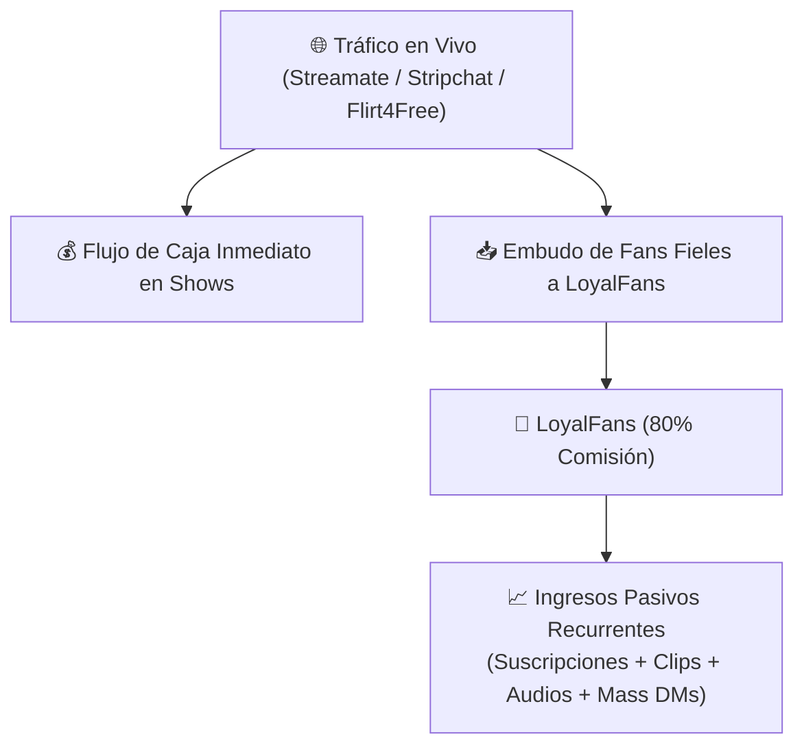

# 📊 Matriz Comparativa de Plataformas — VELVET AI

> **Análisis Técnico Cruzado entre LoyalFans, Streamate, Stripchat y Flirt4Free**  
> *Diseñado para optimizar la toma de decisiones financieras y operativas del estudio.*

---

## ⚖️ Tabla Comparativa Integral

| Criterio | [[LoyalFans_Full_Intelligence\|💎 LoyalFans]] | [[Streamate_Intelligence\|⚡ Streamate]] | [[Stripchat_Intelligence\|🔥 Stripchat]] | [[Flirt4Free_Intelligence\|✨ Flirt4Free]] |
| :--- | :--- | :--- | :--- | :--- |
| **Tipo de Plataforma** | Suscripción, Clips & Red Social Fan Club | Cam por Minuto (Pay-Per-Minute) | Cam Freemium (Tokens) | Cam de Alta Gama (Créditos) |
| **Moneda Base** | USD ($) directo | Gold / USD | Tokens | Créditos |
| **Split para la Modelo** | **80% Neto** | ~30% - 35% | ~50% ($0.05 / token) | ~30% - 40% |
| **Frecuencia de Pago** | Quincenal (Bi-monthly) | Semanal / Quincenal | Semanal / Quincenal | Quincenal / Mensual |
| **Mínimo de Retiro** | **$50.00 USD** | $50 - $100 USD | $20 - $50 USD | $100 USD |
| **Métodos de Cobro** | Paxum, Wire, ACH | Paxum, Wire, ACH | Paxum, Wire, Cripto (USDT) | Paxum, ACH, Wire |
| **Tráfico Orgánico Interno** | **Alto** (Explore feed, SEO de tags fetiche, carrusel Live) | **Medio-Alto** (Grilla según recaudación por hora) | **Masivo** (Rotación pública de carrusel y concursos) | **Medio** (Directorio VIP clasificado) |
| **Dependencia de Redes Externas** | **Baja-Media** (Mucho menor que OnlyFans) | **Muy Baja** (100% tráfico propio del sitio) | **Muy Baja** (100% tráfico propio del sitio) | **Baja** (100% tráfico propio del sitio) |
| **Venta de Audios** | **Nativa (Audio Store exclusiva)** | No | No | No |
| **Venta de Clips pregrabados** | **Excelente (Video Store en USD)** | Regular (Documentos/clips secundarios) | Buena (Álbumes por tokens) | Buena (Tienda por créditos) |
| **Shows 1-on-1 / Cam2Cam** | Sí (Tarifa por minuto propia) | Sí (Core del negocio: PVT/Exclusive) | Sí (Privado por tokens) | Sí (Core del negocio: True Private) |
| **Juguetes Lovense** | Sí (Integración nativa Bluetooth) | Sí (Vía CamModel o Lovense Connect) | Sí (Integración nativa ultra-optimizada) | Sí (Integración nativa) |
| **Agente VELVET Encargado** | **SCARLETT & ELECTRA** | **ELECTRA & ROXANNE** | **SCARLETT & ROXANNE** | **SCARLETT & ROXANNE** |

---

## 🎯 Síntesis Estratégica para el Estudio

1. **Estrategia Híbrida Óptima:**  
   Utilizar las plataformas cam ([[Streamate_Intelligence|Streamate]] y [[Stripchat_Intelligence|Stripchat]]) para capturar flujo de caja caliente y clientes con tarjetas de crédito listas. Luego, redirigir a los clientes fieles hacia [[LoyalFans_Full_Intelligence|LoyalFans]] para retener el **80% de comisión** en suscripciones mensuales, clips y audios.
2. **Rol del Agente ELECTRA:**  
   Monitorea las caídas en las posiciones de la grilla de Streamate y rastrea los cambios de políticas, herramientas y algoritmos en LoyalFans.

---
*Volver al MOC:* [[_MOC_05_VELVET_PLATAFORMAS]]
