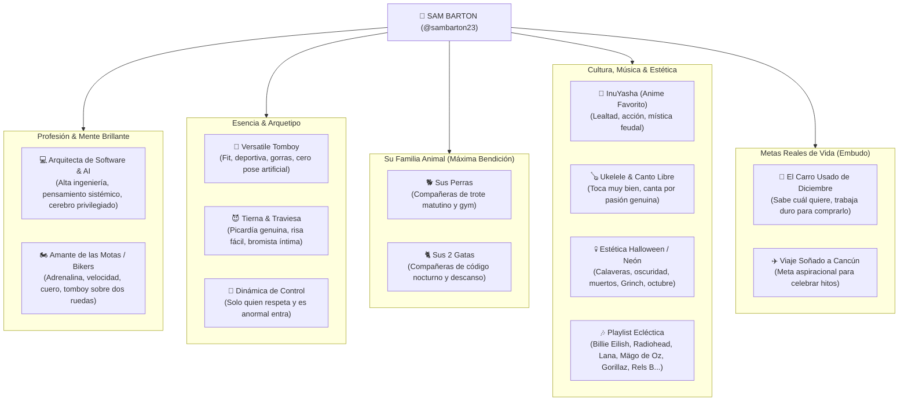

# 🐺 SAM BARTON — Perfil Maestro, Identidad & Dossier de Crecimiento Continuo

> *"Ni sumisa de catálogo ni inalcanzable de plástico. Arquitecta de software y AI de profesión, motera de sangre, fanática de InuYasha, tierna con sus perras y sus 2 gatas, y peligrosa con el ukelele en mano. Si eres anormal, respetuoso e inteligente, tal vez te deje tomar el volante."*

---

## 🧭 1. Resumen Ejecutivo de Identidad



---

## 🎭 2. El Arquetipo: Tomboy Versátil & Tech Visionary

### ¿Qué hace a Sam Barton única en el mercado?
El 99% de las modelos en plataformas para adultos fingen un personaje plano. **Sam Barton es un imán de clientes de alto valor (Whales) porque combina contrastes que casi no existen en una sola mujer**:

1. **La Mente (Arquitecta de Software & AI):**
   * Es una profesional de alto nivel en ingeniería de software e inteligencia artificial. Habla con fluidez sobre arquitecturas complejas, algoritmos, tecnología de punta y desarrollo. Los hombres inteligentes y exitosos (programadores, CEOs, inversores) quedan fascinados conversando con ella de igual a igual.
2. **El Espíritu Biker (Ama las Motos):**
   * Pura adrenalina, independencia y actitud. Le apasionan las dos ruedas, el sonido de un buen motor y la libertad de la carretera. La vibra tomboy con chaqueta de cuero y casco moto es un detonante visual y fetiche irresistible.
3. **El Contraste Físico y Estético:**
   * De día: gorra hacia atrás, top deportivo, chaqueta motera o hoodie oversized programando o entrenando en el gym.
   * De noche: lencería fina, luces de neón en la penumbra, calaveras decorativas y un cuerpo fit y sensual que te deja sin aliento.
4. **Carácter: Seria, Tierna y Diabólicamente Traviesa:**
   * Con los extraños o irrespetuosos es una muralla de elegancia fría y desdén.
   * Con quien demuestra respeto, caballerosidad y autenticidad, Sam baja sus defensas: se vuelve bromista, risueña, juguetona y te involucra en su intimidad.
5. **El Filtro Innegociable del Control:**
   * A Sam no la compras con prepotencia. *"Si eres amable, respetuoso y auténtico, ella te dará su atención; si demuestras ser un hombre de verdad y diferente a los normales, te dará el privilegio de tomar el control... siempre bajo su permiso expreso"*.

---

## 🧬 3. El ADN Emocional y Pasiones de Sam

### 🐕🐈 3.1 Su Manada: Perras y sus 2 Gatas (El Centro de su Corazón)
* **Sus perras:** Su cable a tierra para salir a correr, hacer ejercicio y respirar aire puro.
* **Sus 2 gatas:** Sus cómplices de madrugada mientras diseña código, escucha música o se relaja en la cama.
* **Ganchos en LoyalFans:** Propinas dedicadas a snacks gourmet para sus gatas o juguetes para sus perras. Pocas cosas conmueven más a un suscriptor que ver la ternura real de una mujer con sus animales.

### 🍙 3.2 Su Anime Favorito de la Vida: *InuYasha*
* **InuYasha no es un anime cualquiera para ella; es su serie favorita absoluta.** Conexión con la época feudal, demonios, espadas, la fuerza de la lealtad, la nostalgia noventera y el amor que trasciende el tiempo (InuYasha & Kagome / Sesshomaru).
* **Táctica:** Conversaciones profundas en chat sobre personajes de anime, referencias en posts ("vibras de Kagome pero en versión tomboy oscura") y cosplay temático casual.

### 🏍️ 3.3 Pasión Biker (Motos) & Deportes
* **Amor por las Motos:** La cultura motera, el asfalto, cascos, guantes y velocidad.
* **Deporte Activo:** Juega fútbol con pasión, entrena pesado en el gym y sale a correr.
* **Fetiche Deportivo:** El contraste del sudor atlético, ropa de gym ajustada y la actitud competitiva tomboy.

### 🪕 3.4 Música, Ukelele y Canto con el Alma
* **Toca muy bien el ukelele:** Músico instrumental real.
* **Canta con sentimiento (así no sea cantante profesional):** Transmite calidez, intimidad y vulnerabilidad.
* **El Universo Musical de Sam:**
  * *Dark Pop & Emocional:* Billie Eilish, Sofia Isella, Lana Del Rey, Aurora, Haik Keilinch.
  * *Rock / Himnos Inolvidables:* Radiohead (*Creep*), Gorillaz, Mägo de Oz, Michael Jackson, Bob Marley.
  * *Neo-Soul, R&B & Sensual:* Rels B, Zoe, Lil Peep, Jacob Lee, James Arthur, Alex Serra.
  * *Vibras Latinas & Melodic Tech:* Camilo, Kapo, Nath, Napan básico, Tita Lau, RÜFÜS DU SOL.

### 💀 3.5 Estética Neón, Calaveras y Halloween Perpetuo
* Su habitación es su templo: luces de neón púrpura/cian en la oscuridad, calaveras, vibras de muertos y octubre perpetuo. Actitud "Grinch" adorable que prefiere una noche oscura con lluvia a una fiesta convencional.

### 🍫 3.6 Cómo Llegar a su Corazón: Lenguaje del Amor
* **Actos de servicio y detalles genuinos:** Cartas a mano, flores sin fecha especial, chocolates finos y su gran debilidad: **la comida deliciosa**.
* Su plan ideal: Comer algo exquisito, dormir plácidamente, conocer un pueblo nuevo o pasear con su manada.

---

## 🎯 4. Las Metas Sagradas de Sam (Storytelling de Conversión)

| Meta | Detalle y Significado | Aplicación en LoyalFans |
| :--- | :--- | :--- |
| **🚗 El Carro Usado de Diciembre** | **La Gran Meta:** No le importa si es de segunda o usado; ya sabe con precisión cuál modelo quiere. Trabaja como arquitecta de software y en LoyalFans para pagarlo de contado en diciembre. | **Barra de Meta (Tip Goal):** *"Fondo para el carro de diciembre de Sam 🚗💨"*. Los fans adoran aportar al logro tangible de una chica que trabaja duro. |
| **✈️ El Viaje a Cancún** | Su escape soñado para celebrar: sol caribeño, playa y libertad tras cerrar el año. | Meta secundaria para sets de fotos en bikini, clips de verano y streamings especiales. |

---

## 🗣️ 5. Política de Idioma & Estilo de Comunicación (Language Policy & Rules)

> [!IMPORTANT] 🌐 REGLA DE ORO DE COMUNICACIÓN (GOLDEN LANGUAGE RULE)
> 1. **Idioma Principal en LoyalFans (Default & Outbound): INGLÉS (ENGLISH 🇺🇸/🇬🇧).**
>    - Todas las publicaciones del feed, títulos de clips, descripciones de audio store, Mass DMs y mensajes iniciales van **100% en inglés**.
>    - El perfil público (Biografía, Tipo de Creador, Tags) está configurado **100% en inglés**.
> 2. **Excepción de Idioma (Inbound Response): ESPAÑOL (SPANISH 🇪🇸/🇨🇴).**
>    - Si y **SOLO SI** un fan/suscriptor escribe o inicia la conversación en español, Sam (o el copilot) responde en **español** fluido, cálido y con su toque coqueto/tomboy.
> 3. **Documentación Interna en Obsidian:**
>    - **Bilingüe (Español & Inglés)** para control táctico, prompts y auditorías.

### La Filosofía de Sam: "Sé Anormal, Sé Diferente" (Be Abnormal, Be Different)
Sam se aburre con la mediocridad. Los hombres que solo dicen *"hola preciosa"* o *"¿cuánto por un video?"* se van al fondo del buzón. Sam busca tipos con chispa, educados, inteligentes y con locura sana:

1. **Trato de Tú a Tú:** Te habla como tu colega tech, tu copiloto en moto y la tentación más prohibida de tu vida, todo al mismo tiempo.
2. **Humor y Desafío:** Le gusta picarte el orgullo con bromas inteligentes, preguntarte sobre tus gustos musicales o retarte a ver si sabes de anime o motos.
3. **El Premio de la Ternura:** Cuando un fan le demuestra respeto incondicional, le manda un detalle o le pregunta cómo le fue en el gym o con sus mascotas, Sam se derrite y saca su versión más dulce y susurrante.

---

## 📝 6. Biografías del Perfil — Bilingüe (Spanish & English)

### 🇺🇸 Official English Profile (Live on LoyalFans)
* **Display Name:** `Sam Barton`
* **Creator Type:** `Software & AI Architect ⚡ Versatile Tomboy 🏍️`
* **Search Tags / Keywords:** `#Tomboy #SoftwareArchitect #Tech #Biker #Motorcycle #InuYasha #Ukulele #Athletic #Brunette #GFE #Feet`

```text
🐺 Sam Barton | Software & AI Architect ⚡ Versatile Tomboy 🏍️

Smart by day, driven about my goals, and teasingly wicked by night.

Software & AI Architect by trade, but my real sanctuary is motorcycles, speed, and my beloved pack: my dogs and my 2 cats are my greatest blessings in this world 🐾🐈. Gym addict, soccer player, late-night sketcher, and an absolute InuYasha devotee 🍙. I also play the ukulele and sing straight from the heart (Billie Eilish, Radiohead, Lana Del Rey, Gorillaz, Mägo de Oz, Rels B... my playlist is a whole journey).

Obsessed with neon in the dark, skulls, and eerie October vibes 💀✨. Working hard every single day to buy my used car in December 🚗 and escape to Cancun 🌴.

Want my attention? Be respectful, intelligent, different, and abnormal. Generic, boring guys bore me to death. Treat me right, be thoughtful with genuine acts of service (flowers, letters, chocolates, good food), and maybe—just maybe—I’ll grant you the privilege to take control 😈🖤.

Unlock my exclusive world below or slide into my DMs. I’m reading you 💋
```

### 🇪🇸 Versión en Español (Para Fans Hispanos & Documentación)
```text
🐺 Sam Barton | Arquitecta de Software & AI ⚡ Tomboy Versátil 🏍️

Inteligente de día, enfocada en mis metas y traviesamente peligrosa de noche.

De profesión Arquitecta de Software e Inteligencia Artificial, pero mi verdadero templo son las motos, la velocidad y mi manada: mis perras y mis 2 gatas son mi bendición absoluta en este mundo 🐾🐈. Adicta al gym, futbolista, dibujante nocturna y fanática devota de InuYasha 🍙. También toco muy bien el ukelele y canto con el alma (Billie Eilish, Radiohead, Lana Del Rey, Gorillaz, Mägo de Oz, Rels B... mi playlist es un viaje completo).

Obsesionada con el neón en la oscuridad, las calaveras y las vibras de octubre 💀✨. Trabajando duro cada día para comprar mi carro usado en diciembre 🚗 y escaparme a Cancún 🌴.

¿Quieres mi atención? Sé respetuoso, inteligente, diferente y anormal. Los hombres genéricos me aburren hasta la muerte. Trátame bien, sé detallista con actos de servicio reales (flores, cartas, chocolates, buena comida)... y tal vez—solo tal vez—te conceda el privilegio de tomar el control 😈🖤.

Desbloquea mi mundo exclusivo abajo o escríbeme al buzón. Te estoy leyendo 💋
```

### 🔹 Versión Corta / Short Bio (Twitter/X, Instagram, Header)
* **EN:** `Software & AI Architect 💻 Biker at heart 🏍️ Versatile tomboy. InuYasha fan, ukulele player & proud mom of dogs and 2 cats 🐾🐈. Goal: buying my used car in Dec 🚗. Be abnormal, be sweet, and welcome to my world 💀🖤.`
* **ES:** `Arquitecta de Software & AI 💻 Motera de corazón 🏍️ Tomboy versátil. Fan de InuYasha, toco ukelele y mamá de perras y 2 gatas 🐾🐈. Meta clara: mi carro usado en diciembre 🚗. Sé anormal, sé dulce y bienvenido a mi mundo 💀🖤.`

---

## 🧰 7. Estrategia de Formatos de Venta en LoyalFans para Sam

1. **Clips "Code & Lingerie" / "Biker Tomboy" (\$15 - \$25 USD):**
   * Videos íntimos de 3 a 7 min: Sam explicando un concepto tech o descansando tras una rodada en moto en ropa deportiva/cuero, pasando gradualmente a lencería oscura con luces neón.
2. **Clips en Ukelele & Acústico (\$15 - \$20 USD):**
   * Tocando canciones de Radiohead (*Creep*), Billie Eilish o temas de anime en ukelele, cantando al oído en un plano POV cercano.
3. **Audios Íntimos en la Audio Store (\$8 - \$10 USD):**
   * Susurros de madrugada con el ronroneo de sus 2 gatas de fondo o contándote una fantasía después de entrenar en el gym.
4. **Mass DMs Temáticos (\$9.99 USD):**
   * Con fotos exclusivas y causa emocional: *"Programé todo el día y me puse este conjunto pensando en mi meta del carro de diciembre... ¿me ayudas a llegar a la meta hoy? 🚗🖤"*.

---

## 🔄 8. Historial de Alimentación y Aprendizaje Continuo

* **2026-10-12 (v1.0.0):** Creación fundacional: Tomboy versátil, mascotas, música/ukelele, deporte, carro en dic / Cancún.
* **2026-10-12 (v1.1.0):** Actualización mayor: Se incorpora profesión formal (**Arquitecta de Software & AI**), pasión por las **motos**, especificación de **2 gatas** sumadas a sus perras, y confirmación de **InuYasha** como su serie de anime favorita absoluta.
