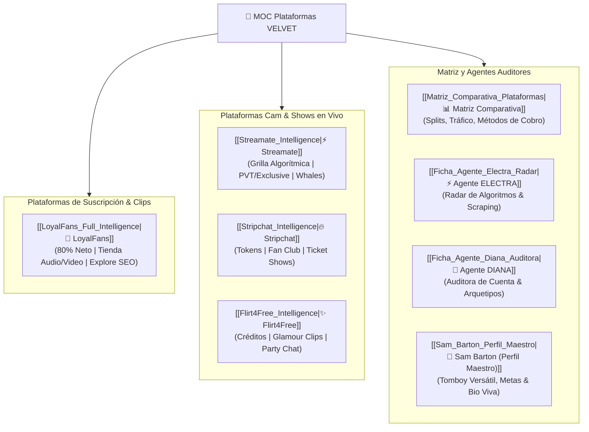

# 🌌 MOC — Inteligencia y Análisis de Plataformas para Creadoras (VELVET AI)

> **Centro de Conocimiento Técnico, Algoritmos, Facturación y Herramientas**  
> *Compilado y auditado por **ELECTRA** (Radar de Algoritmos & Platform Intelligence) bajo la dirección de **VELVET Super-Agent**.*

---

## 🧭 Mapa de Arquitectura y Plataformas

---

## 📂 Índice de Plataformas Auditadas

| Plataforma | Modelo de Ingresos | Tráfico Orgánico | Enlace a la Ficha Técnica |
| :--- | :--- | :--- | :--- |
| **LoyalFans** | Suscripción mensual ($1-$50), Tienda de Video/Audio, Mass DMs PPV, Live | **Alto (Interno)**: Explore Feed, tags de fetiches, banner Go Live | [[LoyalFans_Full_Intelligence\|Ver Análisis Completo LoyalFans]] |
| **Streamate** | Por minuto (PVT / Exclusive / Gold Shows) | **Medio-Alto**: Grilla algorítmica de modelos por recaudación y retención | [[Streamate_Intelligence\|Ver Análisis Completo Streamate]] |
| **Stripchat** | Tokens por propinas, Fan Club, Shows privados | **Masivo (Freemium)**: Algoritmo de rotación y concursos de tokens | [[Stripchat_Intelligence\|Ver Análisis Completo Stripchat]] |
| **Flirt4Free** | Créditos por minuto, tienda de videos glamour | **Medio**: Directorio clasificado y perfil VIP de compradores | [[Flirt4Free_Intelligence\|Ver Análisis Completo Flirt4Free]] |

---

## 🎯 Síntesis Estratégica Ecosistema VELVET

1. **Monetización Pasiva y Reciclaje:** Se centraliza en [[LoyalFans_Full_Intelligence|LoyalFans]] mediante la venta perpetua de clips, audios eróticos y mensajes masivos.
2. **Generación de Flujo de Caja en Caliente:** Se ejecuta en [[Streamate_Intelligence|Streamate]], [[Stripchat_Intelligence|Stripchat]] y [[Flirt4Free_Intelligence|Flirt4Free]] asistido por **ROXANNE** (Copiloto de chat en vivo).
3. **Auditoría de Posiciones y Scraping:** Monitoreado en tiempo real por [[Ficha_Agente_Electra_Radar|ELECTRA]].

---
*Relacionados:* [[Matriz_Comparativa_Plataformas]] | [[Ficha_Agente_Electra_Radar]] | [[LoyalFans_Full_Intelligence]] | [Dashboard Interactivo HTML](file:///c:/Users/MI%20PC/Desktop/Sam/VELVET%20AI/index.html)
